# SARDINE: Summary-statistics-based Association Regression for Deciphering INtegrated cpg Effects

This repository contains the source code for both the R and python `sardine-ewas` packages. Test fixtures ensure that the behavior matches between the R and python packages.

## Overview

Required inputs:

- EWAS summary statistics
- clock weights
- referance methylation variance-covariance matrix

Can handle various types of EWAS summary statistics, based on the following EWAS-generating models:

- linear model (linear regression of phenotype on methylation or methylation on phenotype)
  - can handle either direction of regression (Y~M and M~Y)
  - can handle binary or continuous phenotype
- logistic model (logistic regression of binary phenotype on methylation)
  - for binary phenotypes only
  - direction of regression must be Y~M
- Cox model (regression of time to binary event on methylation)
  - for binary phenotypes (incidence by study end) only
  - direction of regression must be Y~M
  
We then output the following regression estimates (in addition to metadata regarding Var(Y) and the coverage of CpGs):

- linear regression of Y~C (gamma)
- linear regression of C~Y (lambda)
- logistic regression of Y~C approximated from gamma (gamma_logistic)
  - this is for binary phenotypes only
  - this is the log-odds ratio
  - note: for a cox ewas model, this is the log-odds ratio for cumulative incidence at end of follow-up
- log-hazard-ratio (log_hr)
  - this is for a cox ewas model (thus binary phenotype) only

Optional inputs:

- Var(Y): used in the computation of gamma, gamma_logistic, and log_hr. Also needed to compute lambda given a logistic ewas model.
  - the user can input the phenotypic variance, or it will be estimated using the reference methylation variance-covariance matrix
- EWAS DNA methylation scale and mean beta: handles whether EWAS was computed on DNA methylation in beta-value or M-value scale
  - default is beta value
  - mean beta value for each CpG is used to convert M-scale EWAS to beta-scale ewas
- scale and age_adult: used to re-scale Horvath and PedBE clocks
  - age_adult should be set iff scale is set to True
  - TODO: give a full description of this
- cox_pi and cox_E: used to compute kappa_cox
  - only used when EWAS model is Cox
  - describe the proportion (or number) of cases at the end of the study
  - exactly one must be provided if the EWAS model is Cox

## Flow chart

How `sardine()` routes inputs to final estimates.

```mermaid
flowchart TD
    classDef terminal fill:#0e6b6a,stroke:#0a4f4f,stroke-width:2px,color:#ffffff,font-weight:700
    classDef process fill:#ffffff,stroke:#2b6e6e,stroke-width:1.5px,color:#16302e
    classDef decision fill:#eef3f6,stroke:#3d5a66,stroke-width:1.5px,color:#22343b,font-weight:600
    classDef convert fill:#fbe3c0,stroke:#a8541f,stroke-width:2px,color:#5c3312,font-weight:600
    classDef error fill:#f8dede,stroke:#9c333a,stroke-width:2px,color:#5c1414,font-weight:600

    START(["EWAS sumstats + Clock weights + DNAm covariance matrix Σ (+ mean_beta if M-value scale)"]):::terminal
    START --> Q1{"DNAm scale?"}

    Q1 -->|"M-value"| CV1["Convert M-value EWAS → Beta-value scale</br></br>(First-order local-linear approx, at the reference mean β per CpG)"]:::convert
    Q1 -->|"Beta-value"| Q2
    CV1 --> Q2{"EWAS model?"}

    Q2 -->|"Cox (Y~M, binary phenotype only)"| CV2["Convert Cox EWAS (Y~M) → linear Y~M scale (Delta-method approx; scaled by κ(π))"]:::convert
    Q2 -->|"Logistic (Y~M, binary phenotype only)"| Q3log{"Var(Y) supplied?"}
    Q2 -->|"Linear"| Q4{"Direction = Y~M?"}

    Q3log -->|"No"| INF1["Infer Var(Y) from logistic Y~M sumstats + Σ"]:::convert
    Q3log -->|"Yes"| CV4["Convert logistic Y~M → linear M~Y (Delta-method / small-effect approx using Σ, Var(Y))"]:::convert
    INF1 -.->|"EWAS ∩ Σ empty"| ERR1["ERROR: no overlapping CpGs"]:::error
    INF1 --> CV4

    CV2 --> CV3["Convert linear Y~M → M~Y (exact algebraic sumstat inversion)"]:::convert
    Q4 -->|"Y~M"| CV3
    Q4 -->|"M~Y already"| Q5

    CV3 --> Q5{"Var(Y) user-provided (or already estimated in the logistic EWAS model case)"}
    CV4 --> Q5

    Q5 -->|"No"| INF2["Infer Var(Y) from linear M~Y sumstats and Σ"]:::convert
    Q5 -->|"Yes"| ALIGN
    INF2 -.->|"EWAS ∩ Σ empty"| ERR1
    INF2 --> ALIGN["Align CpGs: EWAS ∩ Clock ∩ Σ"]:::process

    ALIGN --> Q6{"Zero overlap?"}
    Q6 -->|"Yes"| ERR1
    Q6 -->|"No"| WBW["Compute wTβ (clock-phenotype signal) and wTΣw (clock variance)"]:::process

    WBW --> Q7{"wTΣw ≤ 0?"}
    Q7 -->|"Yes"| ERR3["ERROR: non-positive clock variance"]:::error
    Q7 -->|"No"| CAP["Cap Var(Y) at wTΣw / (wTβ)²</br></br>(shrinks user-supplied Var(Y) if it exceeds the bound implied by wTβ, wTΣw)"]:::process

    CAP --> EST1["Estimate gamma: Phenotype ~ Clock (linear regression)"]:::process
    EST1 --> EST2["Estimate lambda: Clock ~ Phenotype (linear regression)"]:::process

    EST2 --> Q8{"Binary phenotype?"}
    Q8 -->|"Yes"| CV5["Convert gamma → logistic (log-odds) scale</br></br>(Delta-method approx, with z and p-values inherited from the linear-scale gamma). Note: for a Cox EWAS model, this is the log-odds ratio for cumulative incidence at end of follow-up, which is distinct from the log-hazard ratio computed later."]:::convert
    Q8 -->|"No"| Q10
    CV5 --> Q10{"clock_scale = TRUE? (for Horvath / PedBE clocks)"}

    Q10 -->|"Yes"| RESC["Rescale gamma, gamma_logistic, and lambda by (1 + age_adult); z and p are unaffected"]:::convert
    Q10 -->|"No"| Q11
    RESC --> Q11{"Cox model?"}

    Q11 -->|"Yes"| CV6["Compute clock-level log hazard ratio</br></br>(If Var(Y) was inferred, this is an exact algebraic inverse of the earlier Cox conversion using κ(π). Otherwise, this is an approximation and is sensitive to π. z and p are inherited from linear gamma estimate.)"]:::convert
    Q11 -->|"No"| DONE
    CV6 --> DONE(["Assemble result: lambda, gamma, gamma_logistic (if binary), log_HR (if Cox)"]):::terminal
```

## Development infrastructure and environment management

Set up once with `pixi install` (or let `pixi run` do it lazily on first use). Three environments are defined in `pixi.toml`:

- `dev` — everything: Python + R runtime deps, plus dev tooling for both (`pytest`, `hatchling`, `python-build`, `twine`; `devtools`, `usethis`, `testthat`, `roxygen2`, `covr`, `pkgdown`).
- `user-python` — only the Python package's runtime deps (`numpy`, `pandas`, `scipy`), plus `pip` for installing the built wheel. Approximates a real user's environment; use it to sanity-check that a built wheel/sdist actually installs and runs with nothing but its declared dependencies.
- `user-r` — only the R package's runtime dep (`data.table`). Same idea: sanity-check the built source tarball against a clean, dev-tool-free R install.

Run any command inside an environment with `pixi run -e <env> <command>`, or drop into an interactive shell with `pixi shell -e <env>`.

TODO: update the pixi.toml and these notes as packages are added.

### Python

- Run the test suite: `pixi run -e dev test-py`
- Build the package: `pixi run -e dev build-py` (produces a wheel + sdist under `python/dist/`)
- Sanity-check a clean install: `pixi run -e user-python python -m pip install python/dist/*.whl` then exercise the package from that environment

### R

- Regenerate/re-check golden fixtures: `pixi run -e dev generate-fixtures` / `pixi run -e dev run-test-fixtures`
- Document: `pixi run -e dev document-r`
- Run the test suite: `pixi run -e dev test-r`
- Full package check: `pixi run -e dev check-r`
- Sanity-check a clean install: build a source tarball (`pixi run -e dev Rscript -e 'devtools::build("r")'`), then `pixi run -e user-r Rscript -e 'install.packages("path/to/sardine_x.y.z.tar.gz", repos = NULL, type = "source")'`
- Perform CRAN's pre-submission checks: `devtools::check_win_devel()`