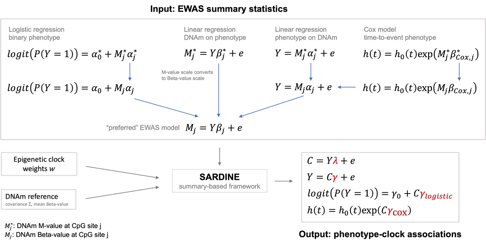

# SARDINE: Summary-statistics-based Association Regression for Deciphering INtegrated cpg Effects

This repository contains the source code for both the R package (`sardine`) and the Python package (`sardine-ewas`). Shared test fixtures ensure that the two packages behave the same, and both are released together under the same version number.

## Algorithm overview

SARDINE computes the association between epigenetic clocks and phenotypes using summary statistics from EWAS studies, clock weights, and a reference DNAm covariance matrix. In other words, SARDINE takes per-CpG effect estimates from EWAS summary statistics, combines them using clock weights and a covariance matrix, and outputs the effect estimate for the clock as a whole.

## Citation

If you use SARDINE, please cite the accompanying manuscript:

Wu Y., Wang Y., Moreno R., Merrill S., Dwaraka V., Seale K., Smith R., Schmitz L., Lu Q. (2026). [SARDINE unlocks EWAS summary statistics for large-scale epigenetic biomarker analysis.](https://www.biorxiv.org/content/10.64898/2026.11.05.763758v1)  _bioRxiv_, 2026.11.05.763758.

## Installation

```r
# R
install.packages("sardine")
```

```sh
# Python (also installs the `sardine` command-line tool)
pip install sardine-ewas
```

To check that the installation works, run SARDINE on the small sample dataset bundled with the package:

```r
# R
library(sardine)
example(sardine)
```

```sh
# Python
python -c "import sardine; print(sardine.example())"

# Command line
sardine --example
```

## Quick start

```r
# R
library(sardine)
result <- sardine(
  ewas_sumstats   = "ewas_sumstats.tsv",
  clock           = "clock_weights.tsv",
  DNAm_cov_matrix = "dnam_covariance.tsv"
)
result                    # the estimates
attr(result, "metadata")  # CpG overlap counts and Var(Y) diagnostics
```

```python
# Python
import sardine

result = sardine.sardine(
    "ewas_sumstats.tsv",
    clock="clock_weights.tsv",
    DNAm_cov_matrix="dnam_covariance.tsv",
)
print(result)  # the estimates (also a DataFrame in result.results)
result.metadata  # CpG overlap counts and Var(Y) diagnostics
```

```sh
# Command line: writes results/my_trait_results.tsv and results/my_trait_metadata.tsv
sardine --ewas_sumstats ewas_sumstats.tsv \
        --clock clock_weights.tsv \
        --DNAm_cov_matrix dnam_covariance.tsv \
        --out results/my_trait
```

## Command-line interface

Installing the Python package (`pip install sardine-ewas`) also installs a `sardine` command, so you can run SARDINE without writing any R or Python code. `python -m sardine` runs the same command.

Each option has the same name as the corresponding input (see [Inputs](#inputs) and [inputs.md](https://github.com/qlu-lab/SARDINE/blob/main/inputs.md)), and accepts the same values:

```sh
sardine --ewas_sumstats FILE --clock FILE --DNAm_cov_matrix FILE --out PREFIX
        [--ewas_direction {M~Y,Y~M}] [--ewas_model {linear,logistic,cox}]
        [--ewas_DNAm_scale {beta,m}] [--ewas_pheno_type {continuous,binary}]
        [--mean_beta FILE] [--N NUMBER]
        [--cox_pi NUMBER] [--cox_E NUMBER] [--scale] [--age_adult NUMBER]
        [--quiet] [--example] [--version]
```

Run `sardine --help` for a description of every option. `sardine --example` runs SARDINE on the small sample dataset bundled with the package and prints the result, without needing any other options, which is a quick check that the installation works.

The progress log and warnings go to stderr, so you can save them separately, e.g. `sardine ... 2> my_trait.log`. The command exits with status 0 on success and 1 if an input is invalid, printing the reason (e.g. `[ERROR] 'ewas_direction' must be 'Y~M' when 'ewas_model' is 'cox'.`).

Examples:

```sh
# Cox EWAS, with 400 cases at the end of the study
sardine --ewas_sumstats ewas_cox.tsv --clock clock_weights.tsv --DNAm_cov_matrix dnam_covariance.tsv \
        --ewas_direction Y~M --ewas_model cox --ewas_pheno_type binary --cox_E 400 \
        --out results/incident_disease

# Logistic EWAS of a binary trait, with M-value methylation
sardine --ewas_sumstats ewas_logistic.tsv --clock clock_weights.tsv --DNAm_cov_matrix dnam_covariance.tsv \
        --ewas_direction Y~M --ewas_model logistic --ewas_pheno_type binary \
        --ewas_DNAm_scale m --mean_beta mean_beta.tsv \
        --out results/case_control
```


### Inputs

See [inputs.md](https://github.com/qlu-lab/SARDINE/blob/main/inputs.md) for full details on every input, including file formats and accepted column names.

The arguments have the same names and accept the same values in R and Python.

| Argument | Required | Default | Accepted values | Description |
| --- | --- | --- | --- | --- |
| `ewas_sumstats` | yes | | file path or table ([format](https://github.com/qlu-lab/SARDINE/blob/main/inputs.md#ewas-summary-statistics-ewas_sumstats)) | EWAS summary statistics: one effect estimate, SE and N per CpG |
| `clock` | yes | | file path or table ([format](https://github.com/qlu-lab/SARDINE/blob/main/inputs.md#clock-weights-clock)) | Clock weights: one weight per CpG |
| `DNAm_cov_matrix` | yes | | file path or table; in R also a matrix or `.rds` file ([format](https://github.com/qlu-lab/SARDINE/blob/main/inputs.md#dnam-covariance-matrix-dnam_cov_matrix)) | Reference DNAm variance-covariance matrix: use one of the reference matrices shared with SARDINE (see [data availability](https://github.com/qlu-lab/SARDINE/blob/main/README.md#data-availability)), or compute your own |
| `ewas_direction` | no | `"M~Y"` | `"M~Y"`, `"Y~M"` | Direction of the EWAS regression (outcome ~ exposure) |
| `ewas_model` | no | `"linear"` | `"linear"`, `"logistic"`, `"cox"` | Regression model the EWAS used |
| `ewas_DNAm_scale` | no | `"beta"` | `"beta"`, `"m"` | Methylation scale of the EWAS: beta values or M-values |
| `ewas_pheno_type` | no | `"continuous"` | `"continuous"`, `"binary"` | Phenotype type; binary also produces `gamma_logistic` |
| `mean_beta` | only if `ewas_DNAm_scale = "m"` | none | file path or table ([format](https://github.com/qlu-lab/SARDINE/blob/main/inputs.md#mean-beta-values-mean_beta)) | Mean beta value per CpG, used to convert M-value sumstats to the beta scale |
| `varY` | no | inferred | non-negative number | Residual phenotype (with the same covariate adjustment as in the EWAS) variance; estimated from the sumstats and covariance matrix if omitted; highly recommended you use default setting and let SARDINE estimate it |
| `N` | no | median of the sumstats' `N` column | number | EWAS sample size |
| `cox_pi` | for Cox, exactly one of `cox_pi` / `cox_E` | none | number strictly between 0 and 1 | Proportion of cases at the end of the study |
| `cox_E` | for Cox, exactly one of `cox_pi` / `cox_E` | none | number $> 0$ | Number of cases at the end of the study |
| `scale` | no | `FALSE` | `TRUE` / `FALSE` | Rescale estimates for the Horvath and PedBE clocks |
| `age_adult` | no | `20` | number | Adult age used in that rescaling |
| `verbose` | no | `TRUE` | `TRUE` / `FALSE` | Print progress and diagnostic messages |

The EWAS model, direction and phenotype type must form one of these combinations:

| `ewas_model` | `ewas_direction` | `ewas_pheno_type` | Also required |
| --- | --- | --- | --- |
| `"linear"` | `"M~Y"` or `"Y~M"` | `"continuous"` or `"binary"` | |
| `"logistic"` | `"Y~M"` | `"binary"` | |
| `"cox"` | `"Y~M"` | `"binary"` (incidence by study end) | exactly one of `cox_pi` / `cox_E` |

- `ewas_DNAm_scale = "m"` works with any of these and also requires `mean_beta`.

### Flow chart

How `sardine()` routes inputs to final estimates.



### Outputs

`sardine()` returns a table with one row per estimated parameter (in Python, `result.results`):

| `param` | `model` | Estimated when | Meaning |
| --- | --- | --- | --- |
| `lambda` | `Clock ~ Phenotype (linear)` | always | Linear regression of the clock on the phenotype |
| `gamma` | `Phenotype ~ Clock (linear)` | always | Linear regression of the phenotype on the clock |
| `gamma_logistic` | `Phenotype ~ Clock (logistic)` | binary phenotype | Log-odds ratio of the phenotype per unit of the clock, approximated from `gamma`. For a Cox EWAS, this is the log-odds ratio for cumulative incidence at the end of follow-up |
| `log_HR` | `Phenotype ~ Clock (Cox)` | Cox EWAS | Log hazard ratio per unit of the clock |

Its columns:

| Column | Description |
| --- | --- |
| `model` | EWAS model used (e.g. `Phenotype ~ Clock (Cox)`) |
| `param` | Parameter being estimated (e.g. `log_HR`) |
| `coef` | Point estimate for the parameter |
| `SE` | Estimated standard error for the point estimate |
| `z` | z-statistic (estimate / SE). All rows share the z of the linear `gamma` test |
| `p` | p-value for the estimate, testing the null hypothesis that the effect is 0 |
| `neglog10p` | -log10(p) (provided due to underflow with very small p-values) |
| `N` | EWAS sample size: the `N` argument if supplied, otherwise the median per-CpG N across the CpGs used |
| `note` | Any notes about the specific settings for this row (e.g. log-odds vs log_HR), or `NA`/`None` |

The result also carries a one-row metadata table for diagnostics, `attr(result, "metadata")` in R and `result.metadata` in Python, with columns:

| Column | Description |
| --- | --- |
| `sardine_version` | Version of SARDINE that produced the result |
| `N_CpGs_ewas`, `N_CpGs_clock`, `N_CpGs_DNAmRef` | Number of CpGs in the EWAS, clock, and DNAm reference dataset respectively |
| `N_CpGs_ewas_clock`, `N_CpGs_ewas_ref`, `N_CpGs_clock_ref` | Number of CpGs overlapping between each pair of inputs |
| `N_CpGs_final` | Number of CpGs in all three inputs; these are the CpGs actually used for the association analysis |
| `ClockCpG_coverage_ratio` | Fraction of the clock's CpGs that ended up in the final set of CpGs used |
| `ClockCpG_missed_ratio` | 1 - `ClockCpG_coverage_ratio` |
| `cox_pi` | Proportion of cases at the end of the study, either input directly or computed from `cox_E`. `NA` if the EWAS model is not Cox |
| `kappa_cox` | Cox conversion factor used to convert from the linear scale gamma to the Cox log hazard ratio. `NA` if the EWAS model is not Cox |
| `varY` | Variance of the residual phenotype (adjusting for exactly the same set of covariates in EWAS), either input directly or estimated using the EWAS summary statistics and the DNAm reference matrix |
| `varY_type` | `user_provided` or `inferred` |
| `varY_ratio` | (varY prior to capping) / (theoretical max varY). The theoretical maximum is the varY you'd get if the clock explained all of the phenotype's variance. You should double-check when this ratio is very close to 1. |
| `varY_note` | Note about whether varY had to be capped at the maximum theoretical phenotypic variance |

### Additional notes

- See [this page](https://github.com/qlu-lab/SARDINE/blob/main/assets/cox_model_notes.md) for additional notes about using SARDINE with a Cox EWAS model.

## Data availability

The data associated with the SARDINE manuscript can be downloaded from Globus [here](https://app.globus.org/file-manager?origin_id=bf219067-1e45-45d8-b2ec-5fa04a8b507c&origin_path=publicly_shared_files) under the following file paths:

- TruDiagnostic methylation data summary stats ([README](https://g-314ba8.dtn.globus.wisc.edu/publicly_shared_files/Projects/SARDINE/TruDiagnostic_methylation_data/README.md))
  - Methylation covariance matrices (subset to clock CpGs): `Projects/SARDINE/TruDiagnostic_methylation_data/clock-specific_methylation_varcovar_matrices`
  - Mean beta values: `Projects/SARDINE/TruDiagnostic_methylation_data/mean_beta`
  - EWAS summary statistics generated from TruDiagnostic data: `Projects/SARDINE/TruDiagnostic_methylation_data/EWAS_sumstats`
- Weights for the publicly-available clocks we analyzed ([README](https://g-314ba8.dtn.globus.wisc.edu/publicly_shared_files/Projects/SARDINE/clock_weights/README.md))
  - File path within Globus: `Projects/SARDINE/clock_weights`

## Development infrastructure and environment management

Set up once with `pixi install` (or let `pixi run` do it lazily on first use). Three environments are defined in `pixi.toml`:

- `dev` — everything: Python + R runtime deps, plus dev tooling for both (`pytest`, `hatchling`, `python-build`, `twine`; `devtools`, `usethis`, `testthat`, `roxygen2`, `covr`, `pkgdown`).
- `user-python` — only the Python package's runtime deps (`numpy`, `pandas`, `scipy`), plus `pip` for installing the built wheel. Approximates a real user's environment; use it to sanity-check that a built wheel/sdist actually installs and runs with nothing but its declared dependencies.
- `user-r` — only the R package's runtime dep (`data.table`). Same idea: sanity-check the built source tarball against a clean, dev-tool-free R install.

Run any command inside an environment with `pixi run -e <env> <command>`, or drop into an interactive shell with `pixi shell -e <env>`.

### Running the tests

| Command | What it checks |
| --- | --- |
| `pixi run -e dev test-r` | Every R test: all shared fixture cases plus the R-only tests (e.g. covariance matrix given as an R object) |
| `pixi run -e dev check-r` | `R CMD check`: builds the package, runs `test-r` and the `example(sardine)` example, and checks the docs and package structure, as CRAN does |
| `pixi run -e dev test-py` | Every Python test: all shared fixture cases plus the Python-only tests (e.g. covariance matrix given as a DataFrame, and the command-line interface) |
| `pixi run -e dev check-py` | Runs `test-py`, builds the Python package, and checks that it will render correctly on PyPI (`twine check`). The Python counterpart of `check-r` |
| `pixi run -e dev check-sync` | That the shared files match their copies in the packages |

`test-r`, `check-r`, `build-r`, `test-py` and `build-py` all run `sync` first, so they always use the current shared files.

### Shared files

The repo root holds the files both packages share; `pixi run -e dev sync` copies them into the packages, and `pixi run -e dev check-sync` fails if any copy is out of date:

- `VERSION`: the single version number for both packages, copied into `r/DESCRIPTION` and `python/src/sardine/_version.py`
- `fixtures/`: test inputs and expected outputs, copied into `r/inst/extdata/fixtures/` because `R CMD check` cannot see files outside `r/`. The inputs at `fixtures/inputs/` is also copied into `python/src/sardine/example_data/` for `sardine.example()`. The Python tests read `fixtures/` directly, and the Python build copies it into `tests/fixtures/` inside the sdist, so the tests can also run from an unpacked sdist (e.g. for conda-forge)
- `README.md` and `LICENSE`: copied into `python/`, because the Python build cannot see files outside `python/` and PyPI shows the README as the package description

Edit these only at the repo root, never their copies.

Fixtures:

- Each fixture case is checked for its results, metadata, error message and printed stdout/stderr, by `r/tests/testthat/test-fixtures.R` in R and `python/tests/test_fixtures.py` in Python
- In the expected stdout/stderr, each warning is saved as a `Warning: <message>` line to account for the fact that R and Python print warnings differently.
- The comparison skips the table rows printed under each `[INFO] ... header:` line, since their layout depends on each language's table printing
- An error's message is compared against `<case>_error.txt`, not stderr
- Regenerate fixtures: `pixi run -e dev generate-fixtures`. Only do this when an expected output should change (e.g. a bug fix), and review the diff
- The version is stored as `<VERSION>` in the expected outputs so bumping the version never requires regenerating them, and time stamps are similarly stored as `<TIMESTAMP>`

### Python

The Python package lives in `python/` (code in `python/src/sardine/`, tests in `python/tests/`). It mirrors the R package file for file (`utils.py` ↔ `utils.R`, `io.py` ↔ `io.R`, and so on, with `result.py` ↔ `print.R`) with the same function names. The command-line interface (`cli.py`, also run by `__main__.py`) is Python-only; it is a thin wrapper that parses the options, calls `sardine()`, and writes the two output TSV files. The `sardine` command itself is declared under `[project.scripts]` in `python/pyproject.toml`.

- Run all Python tests: `pixi run -e dev test-py` (see [Running the tests](#running-the-tests))
- Build the package: `pixi run -e dev build-py`: builds `dist/sardine_ewas-<VERSION>-py3-none-any.whl` and `dist/sardine_ewas-<VERSION>.tar.gz`
- Full package check: `pixi run -e dev check-py` (runs all Python tests, builds the package, and checks it will render correctly on PyPI)
- Sanity-check a clean install in the minimal `user-python` environment, which has only the runtime dependencies:
  1. `pixi run -e dev build-py`: builds the wheel
  2. `pixi run -e user-python install-py`: installs that wheel and checks its declared dependencies are satisfied (`pip check`)
  3. `pixi run -e user-python example-py`: runs the example on the bundled sample data as a user would, both from Python (`sardine.example()`) and through the installed command (`sardine --example`)

### R

The R package lives in `r/` (code in `r/R/`, tests in `r/tests/testthat/`). `NAMESPACE` and `man/` are generated by roxygen; don't edit them by hand.

- Document: `pixi run -e dev document-r`
- Run all R tests: `pixi run -e dev test-r` (see [Running the tests](#running-the-tests))
- Full package check: `pixi run -e dev check-r`
- Sanity-check a clean install in the minimal `user-r` environment, which has only the runtime dependencies:
  1. `pixi run -e dev build-r`: builds `dist/sardine_<VERSION>.tar.gz`
  2. `pixi run -e user-r install-r`: installs that tarball
  3. `pixi run -e user-r example-r`: runs `example(sardine)` on the bundled sample data, as a user would
- Check on CRAN's Windows development build (results arrive by email): `pixi run -e dev Rscript -e 'devtools::check_win_devel("r")'`

### Publishing an update

The R and Python packages should always be released together, with the same version number, and only once both pass the same fixtures.

1. **Make and test the change in both packages.** Any change to behavior, inputs or outputs goes into both the R and Python code. If the change should alter an expected output, update `fixtures/` (manually or via `generate-fixtures` or a new case) and check that both packages match it.
2. **Bump `VERSION`** at the repo root, following [semantic versioning](https://semver.org): patch (`0.1.1`) for bug fixes, minor (`0.2.0`) for new features, major (`1.0.0`) for changes that break existing code. Use plain `X.Y.Z`, which is valid for both CRAN and PyPI. Never edit the version in `r/DESCRIPTION` or `python/src/sardine/_version.py` directly.
3. **Add an entry to [CHANGELOG.md](https://github.com/qlu-lab/SARDINE/blob/main/CHANGELOG.md)** under the new version.
4. **Sync and regenerate:**
   - `pixi run -e dev sync`
   - `pixi run -e dev document-r`
5. **Run every check.** All must pass before releasing:
   - `pixi run -e dev check-sync`
   - `pixi run -e dev check-r`: runs all R tests and the example, plus CRAN's package checks; aim for 0 errors, 0 warnings, 0 notes
   - `devtools::check_win_devel("r")` for CRAN's other platforms (results arrive by email)
   - `pixi run -e dev check-py`: runs all Python tests, builds the package, and checks it will render correctly on PyPI
   - Install both built packages in the clean `user-r` and `user-python` environments and run the examples (see the R and Python sections above)
6. **Commit, tag and push:**
   - `git commit -am "Release vX.Y.Z"`
   - `git tag vX.Y.Z`
   - `git push && git push --tags`
7. **Publish both packages**, within the same day where possible:
   - R: from `r/`, run `devtools::submit_cran()`, then confirm the submission from the email CRAN sends the maintainer. CRAN review can take a few days, and they may ask for changes; if so, make them, bump the patch version, and repeat from step 2 for both packages.
   - Python: `pixi run -e dev build-py`, then `pixi run -e dev twine upload dist/sardine_ewas-*`
     - Uploading needs a PyPI API token (create one under your PyPI account settings, then enter `__token__` as the username and the token as the password, or save them in `~/.pypirc`).
     - Can first upload to TestPyPI first (`twine upload --repository testpypi dist/sardine_ewas-*`, with a separate TestPyPI account) and install from there (`pip install --index-url https://test.pypi.org/simple/ --extra-index-url https://pypi.org/simple/ sardine-ewas`) to check the package page and install
   - GitHub: create a release from the `vX.Y.Z` tag, with the CHANGELOG entry as its notes.
